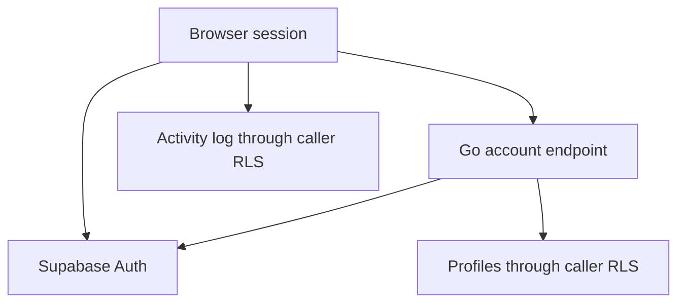

# Secure Go / Angular migration

## Implemented flow

1. Existing Supabase sign-in establishes the browser session.
2. Angular `/next/` reads the session from the shared Supabase client and calls same-origin `/api/account` with a bearer token.
3. Go validates that token against Supabase Auth on every request. It never treats a decoded JWT or browser state as proof of identity.
4. Go queries only the verified user's profile with the user's bearer token, so database RLS is still enforced. Missing, unconfirmed, inactive and suspended accounts are denied.
5. Angular displays a read-only account result and clears stale data on refresh, error or sign-out. It does not expose admin controls or execute transfers.

Public web configuration and provider secrets are separate. This slice needs no service-role credential. Go never logs tokens or returns upstream error bodies. Requests have timeouts, response-size limits and explicit method handling. CORS does not grant account access: authorization is mandatory for every API call. A stolen bearer token remains usable until expiry/revocation; XSS prevention, provider session policies and MFA are separate controls.

## Existing frontend hardening

Executable inline scripts were moved into external files so `script-src` no longer needs `unsafe-inline`. Structured JSON-LD uses an exact hash. Response CSP sets `frame-ancestors 'none'`; X-Frame-Options is DENY, MIME sniffing is disabled and cross-origin access is restricted to the canonical origin. Admin styles and Angular component styles are now external assets. The response policy contains no `unsafe-inline` allowance for scripts or styles. The admin page uses system fonts, eliminating an external font stylesheet without integrity metadata.

The browser guard supports navigation and UX; it cannot replace RLS or server checks. Supabase browser session timeout controls are not server-side revocation. Existing admin RPC permissions and MFA still need end-to-end coverage before broader backend migration.

## Staged replacement

The Go/Angular account slice is additive. Root landing, auth, admin, legal and dashboard pages retain the existing design and routes. Full migration requires moving those routes and their tests into Angular, versioning the current SQL/Edge Function baseline, and proving parity before routing production users away from the existing dashboard.

Future KYC and payout endpoints must check account eligibility server-side, verify signed webhooks, use immutable audit records, enforce idempotency, and keep payment secrets server-only. The current slice intentionally exposes no mutation endpoints. No simulated payment is represented as a completed transaction.

## Database reporting boundary

The proposed migration removes reporting access to raw public tables and future default grants. Two reporting views return aggregate counts by account/KYC status. They intentionally execute as their owner and contain no identifiers, emails, phone numbers, tokens or transaction details. Browser roles receive no access to the reporting schema. Existing Power BI datasets must switch to these aggregate views; the old raw-table schema is not preserved.

Schema changes must be tested with `supabase/tests/reporting_permissions.sql`. The migration uses short lock/statement timeouts and assertions to abort rather than leave partial grants. It does not alter customer records. Its execution status is tracked in the remediation report.

## Classification and data ownership

This repository is a **fintech web application**: static JavaScript plus a staged Angular frontend, a read-only Go account API and Supabase-backed authentication/authorization. `supabase/migrations` versions database schema and permissions. It is not an ETL pipeline, scheduler or data-orchestration subsystem. Do not add artificial pipelines to satisfy a misclassified assessment dimension.

Current account flow and trust boundaries:

`profiles.id` is matched to the Auth-verified user ID for account reads. The login page writes a best-effort `activity_log` event with that same user ID after checking active status. That browser-originated event is not an authoritative financial ledger or proof of successful authentication. Admin changes use named `admin_*` RPCs, whose server permissions are the authorization boundary; UI restrictions are only defense in depth. Ledger and payout mutations are outside this Go slice and remain disabled for live use.

`supabase/tests` contains permission and ledger regression SQL. These tests need the existing database schema; they do not establish a complete fresh-install baseline. Synthetic role checks test unauthorized reads and RPC calls. Reporting tests validate aggregate-only grants after the proposed migration. A complete export of schema, functions, triggers, RLS and reviewed seed fixtures remains required before disposable database CI can be claimed.

## Module and diagnostics boundaries

`admin-helpers.js` owns safe DOM construction and display formatting; `admin-charts.js` owns charts; `admin-ui.js` owns reusable controls; `admin-user.js` owns the account drawer; `admin-1.js` wires navigation, views, RPCs and boot. Dependencies are explicitly injected and scripts load in order. Existing external script loading and CSP remain intact.

`pkg/observability` wraps HTTP entry points with locally generated correlation IDs, status/timing JSON logs and generic panic handling. Logs exclude URL parameters, headers, bodies and identity data. `/api/health` is liveness only. External alerting, metrics retention and authenticated production monitoring are not configured by this change.
