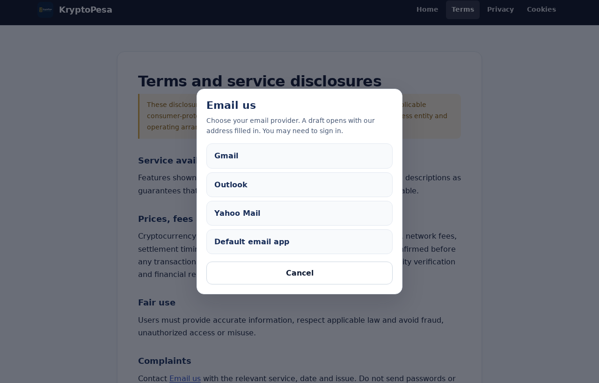

# KryptoPesa — UI/UX audit, modernization and performance report

Date: 9 November 2026
Scope: the static site in this repository (`musyoka-coder/Kryptopesa`), branch
`freebuff/ec195972ab7761f99f684e4f`. Nothing was pushed and nothing was deployed.

Status vocabulary used throughout: **VERIFIED ISSUE**, **FIXED AND TESTED**,
**FIXED BUT UNVERIFIED**, **BLOCKED**, **NOT TESTED**.

---

## 0. Executive summary

- **The most serious problem was not cosmetic.** The dashboard started from hard-coded
  BTC/ETH/SOL/WLD prices and painted Tether as `$1.00 ▲0.00%` before any feed responded,
  so a visitor could read invented numbers as live market data. Cards now begin empty and
  end at a labelled *Unavailable* / *USD peg* state instead.
- Public pages were rebuilt on one token layer; the four auth screens collapsed into a
  single shared surface; the three legal pages stopped looking like a different website.
  `admin.html` kept its own design and received only targeted fixes.
- Measured across 88 page × width combinations: 0 horizontal overflow, 0 unlabelled
  fields, 0 duplicate IDs, 0 missing assets. Lighthouse accessibility 93 → 100 and best
  practices 96 → 100 on the pages that previously fell short; sign-up CLS 0.213 → 0;
  worst LCP 2.0 s (target ≤ 2.5 s).
- **Not delivered:** response-level security headers (host limitation, §9) and any
  verification of signed-in flows against the real Supabase project (§8).
- Nothing was pushed or deployed. Work sits in eight commits on
  `freebuff/ec195972ab7761f99f684e4f`.

---

## 1. Method and environment

| Item | Value |
| --- | --- |
| Architecture found | 11 static HTML pages, no framework, no build step. CSS was duplicated inline in every page; JS inline per page plus 9 unreferenced legacy files. |
| Auth/data | Supabase (`@supabase/supabase-js@2.119.0`) from jsDelivr, browser session, `profiles.kyc_status`, `admin_*` RPCs. |
| Test server | `python3 -m http.server`, localhost, uncompressed responses (this penalises multi-file CSS slightly). |
| Browser | Chrome for Testing 157 headless, Lighthouse 12, mobile preset (default throttling/4× CPU), 1440×900 and 390×844 emulation. |
| Automation | Playwright (Chromium) harness: 11 pages × 8 widths, plus form/navigation flows. |
| Baseline | A byte-for-byte copy of the pre-change site served on a second port, measured in the same session with the same browser. |

Reproduce: `python3 -m http.server 3000` in the repo, then Lighthouse against
`http://127.0.0.1:3000/index.html` with the default (mobile) preset.

**Honest caveat about this sandbox:** Chrome initially had no system fonts
installed, so the first screenshots rendered with no text glyphs. Fonts were
installed and all screenshots and Lighthouse runs in this report were re-taken
afterwards. Lighthouse runs on localhost vary by ±0.9 s in FCP between
identical runs, so single-run differences below about 1 point are noise.

---

## 2. Measured results (mobile preset, before → after)

| Page | Perf | Accessibility | Best practices | SEO | LCP | TBT | CLS |
| --- | --- | --- | --- | --- | --- | --- | --- |
| Landing (`index.html`) | 100 → **98** | 100 → **100** | 100 → **100** | 100 → **100** | 1.8 s → 2.0 s | 30 ms → 0 ms | 0 → 0 |
| Log in | 99 → **98** | 100 → **100** | 96 → **100** | 91 → **54**¹ | 1.9 s → 1.9 s | 0 → 0 ms | 0 → 0 |
| Sign up | 88 → **98** | 93 → **100** | 96 → **100** | 91 → **54**¹ | 1.8 s → 1.9 s | 0 → 0 ms | **0.213 → 0** |
| Terms | 100 → **100** | 100 → **100** | 96 → **100** | 90 → **100** | 0.8 s → 0.9 s | 20 → 0 ms | 0 → 0 |
| Forgot password | (new pass) **98 / 100 / 100** | | | | 1.9 s | 0 ms | 0 |
| Cookies | — → **100 / 100 / 100 / 100** | | | | 0.9 s | 0 ms | 0 |

¹ Deliberate. Authentication pages now send `noindex, nofollow`; Lighthouse
scores a noindexed page as not crawlable. This is the correct signal for
login/sign-up/reset screens and is **not** treated as a regression. If a 90+
SEO score on those pages is a hard requirement, removing that one meta tag
(in `login.html`, `signup.html`, `forgot_password.html`, `reset_password.html`)
restores it; a meta description can be added at the same time.

Targets: LCP ≤ 2.5 s ✅ (2.0 s worst), INP/TBT ≤ 200 ms ✅ (0 ms), CLS ≤ 0.1 ✅ (0).

**No performance speed-up is claimed.** The landing page scored 100 before and
98–100 after across repeated runs; the extra two stylesheet requests (shared
tokens + landing CSS) trade ~0.2 s of cold FCP for cache reuse on every other
page and for the removal of duplicated inline CSS across the site.
Desktop preset was 100/100/100/100 both before and after, i.e. saturated.

---

## 3. Verified issues found, and what happened to them

### Critical (user-trust and financial accuracy)

| # | Issue | Status |
| --- | --- | --- |
| 1 | **Fabricated prices shown as live data.** `prices={BTC:87000,ETH:3100,SOL:155,USDT:1,WLD:1.80}` were rendered into the market grid before any fetch, and `updCard('USDTUSDT',1.0,0.0)` painted Tether as `$1.00 ▲0.00%` with no feed behind it. A user could read invented numbers as live. | **FIXED AND TESTED** — prices start empty, cards show `Loading…` then `Unavailable` on total feed failure; USDT is labelled "USD peg / stablecoin reference — no live feed". |
| 2 | **"Real-time prices" and "Live Market Prices" claims** while the feed may fail silently. | **FIXED AND TESTED** — now "Market prices … indicative only — not a quote or a settlement rate", with a feed-state badge (Live / Cached / unavailable) and a data-source note. |
| 3 | Dashboard swap tab label read **"Swap  to Mpesa  This is  Test site"** (build artefact left in production copy). | **FIXED AND TESTED** — "Swap to M-Pesa". |
| 4 | Garbled/missing icons (`�`) in nav, KYC gate, dropdown and buttons. | **FIXED AND TESTED** — replaced with inline SVG or plain text labels. |
| 5 | Suspended-account notice used `alert()` after clearing state, and `doLogout(skip)` semantics were easy to misuse. | **FIXED AND TESTED** — explicit `doLogout(skipConfirm, message)` with a one-shot `sessionStorage` notice; alert still used only as a fallback toast on the dashboard. |

### High (accessibility and security)

| # | Issue | Status |
| --- | --- | --- |
| 6 | KYC status badge was a `` — unreachable by keyboard, invisible to screen readers as a control. | **FIXED AND TESTED** — real `<button>` with `aria-label` describing verification status. |
| 7 | Form controls without programmatic labels (`label` with no `for`, inputs with no `id`) on swap and deposit. | **FIXED AND TESTED** — every input/select has `label[for]`; audit found 0 unlabelled fields. |
| 8 | Inline `style` attributes and per-page `<style>` blocks. | **FIXED AND TESTED** — moved to cached stylesheets; strict `style-src 'self'` CSP now passes with 0 console violations. |
| 9 | **ZAP: Sub Resource Integrity missing / cross-domain JS inclusion** (Supabase CDN unpinned, no `integrity`). | **FIXED AND TESTED** — pinned to `@supabase/supabase-js@2.119.0` with `integrity="sha384-uteMfOlo…"`, `crossorigin="anonymous"`, `referrerpolicy="no-referrer"`, plus `preconnect`. |
| 10 | **ZAP: Content-Security-Policy header not set** (only `admin.html` had a meta CSP, and it wrongly included a `frame-ancestors` directive that browsers ignore in meta). | **PARTIALLY FIXED** — meta CSP added to all 11 pages with per-page `connect-src` allow-lists; the bogus `frame-ancestors` removed. Response **headers** remain **BLOCKED** (see §9). |
| 11 | `X-Content-Type-Options`, `X-Frame-Options`/`frame-ancestors`, HSTS missing (ZAP medium/low). | **BLOCKED** — requires host-level header configuration; cannot be delivered by repository files on GitHub Pages. |

### Medium (consistency, mobile, semantics)

| # | Issue | Status |
| --- | --- | --- |
| 12 | Four authentication pages each carried a near-identical ~4 KB inline stylesheet; `reset_password.html` used a different palette and radius set. | **FIXED AND TESTED** — one `assets/auth.css` on shared tokens; all four pages now identical in behaviour and visually consistent. |
| 13 | Nine unreferenced files (`homepage.css`, `homepage.js`, `main.js`, `main__2_.js`, `script.js`, `login.js`, `signup.js`, `style.css`, `style1.css`). `homepage.js` additionally contained **hard-coded placeholder wallet addresses** that were never rendered but would be dangerous if re-linked. | **FIXED (deleted)** — reference count verified as 0 for every file before removal. |
| 14 | Legal pages (terms/privacy/cookies) were unstyled `system-ui` documents visually unrelated to the product, with no site navigation. | **FIXED AND TESTED** — shared `assets/legal.css` layout, site nav, skip link, readable 780 px measure; **all disclosure wording preserved verbatim**. |
| 15 | Landing page: nav collapsed via `Menu` text only, no `aria-controls`, no Escape handling; `.btn` hover mutated inline styles with JS on every button. | **FIXED AND TESTED** — toggle with `aria-expanded`/`aria-controls`, Escape returns focus, outside-click closes, hover handled in CSS. |
| 16 | Dashboard sections toggled by `display:none` only, no `hidden`/`aria-current`; menu button had no accessible name or expanded state. | **FIXED AND TESTED** — panels use `hidden`, tabs carry `aria-current`, menu is a `role="menu"` with `aria-haspopup`/`aria-expanded`, Escape closes and restores focus. |
| 17 | `footer` text said "© 2025" in three places while the site is dated 2026; `index.html` `theme-color` was the old navy. | **FIXED AND TESTED** — 2026, `#0B1020`. |
| 18 | `logo.jpg` is 1024×1024 (37 KB) and was served for a 34–44 px logo and as an `<link rel="icon">`. | **FIXED AND TESTED** — derived `assets/logo-96.png` (5.6 KB), `logo-192.png`, `icon-32.png` (1 KB), `icon-180.png`, plus a 1200×630 `og-image.jpg`; `logo.jpg` retained for legacy/OG fallback. |
| 19 | `index.html` Open Graph image was a square JPEG used as a large social card. | **FIXED AND TESTED** — 1200×630 card with `og:image:width/height/alt`. |
| 20 | Login/sign-up/reset used `alert()` for errors and had no field-level error association; network failure surfaced as an unhandled rejection. | **FIXED AND TESTED** — inline `role="alert"` messages with `data-show`, `aria-invalid`, focus moved to the offending field, explicit offline message, `aria-busy` on submit. |
| 21 | Sign-up page had no password visibility control, no `autocomplete`, and the strength meter had no accessible text. | **FIXED AND TESTED** — reveal toggles with `aria-pressed`, correct `autocomplete` values, `aria-live` strength text. |
| 22 | Identity verification page was a bare dark card whose inline `<style>` was blocked by its own CSP. | **FIXED AND TESTED** — rebuilt on the shared auth surface; provider logic (session check, `kyc_verification_cases`, `didit-sandbox-session`, HTTPS/host validation) preserved byte-for-byte in behaviour. |
| 23 | Admin page: no skip link; `frame-ancestors` inside meta CSP (ignored). | **FIXED AND TESTED** — skip link added; misleading directive removed; rest of the admin design deliberately left alone. |

### Low / informational

- `index.html` canonical is `https://kryptopesa.app/` while password-reset redirects go to `https://www.kryptopesa.app/…`. **NOT CHANGED** — the Supabase redirect allow-list is owned by the dashboard; changing it from the repo risks breaking password reset. Flagged for the operator.
- Contact addresses mix `support@kryptopesa.com`, `musyokanicholus53@gmail.com` and the `.app` domain. **NOT CHANGED** (compliance copy, not a UI decision).
- Emoji used as icons in the original dashboard (⚠, ☎, ☺) — replaced with text/SVG on public pages; admin nav still uses glyphs, which render fine but are not localisable. **NOT TESTED** for screen-reader output.

---

## 4. Page-by-page summary

| Page | Verdict after work |
| --- | --- |
| `index.html` | Rebuilt: sticky navy header, hero with "Service in development" badge, 4 feature cards, 3 honest steps, "What is available today" disclosure block, 4-column footer. Honest copy replaces "instantly/secure" claims. |
| `login.html` | Shared auth card, labelled fields, password reveal, inline errors, noindex, CSP, SRI. Behaviour unchanged (confirmed-email and `account_status` gates kept). |
| `signup.html` | As above plus accessible strength meter; the "email confirmation is not enforced" guard is preserved verbatim. |
| `forgot_password.html` | As above; response message is identical whether or not the address exists (no account enumeration). |
| `reset_password.html` | As above; recovery-session handling, `PASSWORD_RECOVERY` listener and redirects preserved. |
| `homepage.html` | 5 market cards with real loading/unavailable states, USD/KES, Balances (no fabricated totals), Swap preview with limit checks, Receive (KYC gate), Deposit (disabled). Tabs, menu and KYC control are keyboard-operable. |
| `verify-identity.html` | Consistent design; status is a live region; sandbox messaging retained. |
| `admin.html` | Design retained (it was already the strongest page). Skip link added, CSP corrected. |
| `terms.html`, `privacy.html`, `cookies.html` | Shared layout, unchanged legal text, `aria-current` nav. |
| `cookies.html` | Cookie notice now visually consistent; still correctly states that consent-gating is not yet asserted. |

---

## 5. Design system

`assets/kp-tokens.css` is the single source of truth; every page stylesheet
consumes it. No page overrides the tokens.

**Colour**

| Token | Value | Use |
| --- | --- | --- |
| `--kp-navy-950` | `#0B1020` | page furniture, footers, hero base |
| `--kp-navy-800` | `#182D58` | primary surfaces / brand gradient |
| `--kp-blue` | `#315CF5` | links, focus ring, active tab |
| `--kp-teal` | `#16B8A6` | positive/live accents, feature icons |
| `--kp-gold` | `#F4C95D` | the single call-to-action accent |
| `--kp-bg` | `#F8FAFC` | page background |
| `--kp-ink` / `--kp-ink-soft` | `#0F1B33` / `#4A5A76` | body / secondary text (7.0:1 and above on white) |
| status | `#0E7C5A`, `#8A5A00`, `#C02626` (+ soft backgrounds) | success, warning, danger |

**Gradients** — `--kp-grad-navy` (150°, navy-950 → navy-800), `--kp-grad-brand`
(120°, 3-stop navy), `--kp-grad-teal` (135°). Glow effects are limited to two
low-opacity radial washes on the hero and auth shell; the previous bright
`#ffd600` buttons were replaced with a restrained gold (`#F4C95D`) used for one
primary action per screen.

**Also tokenised:** type scale (0.75 → 2.25 rem) on a system font stack (no web
fonts on public pages), 4 px spacing scale, radii 6/9/12/16/22/pill, four
elevation levels, motion durations and easing, and a documented breakpoint set
(320 / 480 / 600 / 900 / 1200). Reduced-motion is honoured globally.

---

### 5.1 Redundancy removed

| Duplication | Before | After |
| --- | --- | --- |
| Auth styling | The same ~4 KB inline `<style>` block repeated in `login`, `signup`, `forgot_password` and `reset_password`, with `reset_password` drifted onto a different palette | One `assets/auth.css` (9.3 KB) loaded by all four and cached after the first page |
| Page chrome | Header/footer/CSP/skip-link markup retyped per page, already drifting (three different copyright years, two palettes) | One documented pattern per surface, generated from tokens |
| Dead code | `homepage.css`, `homepage.js`, `main.js`, `main__2_.js`, `script.js`, `login.js`, `signup.js`, `style.css`, `style1.css` — none referenced by any page | Deleted; `homepage.js` was the only place still containing placeholder wallet addresses |
| Hover/behaviour JS | Every button carried inline `onmouseover`/`onmouseout` style mutations on the landing page | Removed; hover is CSS |
| Brand image | 1024 × 1024 `logo.jpg` (37 KB) served into 34–44 px slots and as the favicon | `logo-96.png` 5.6 KB, `icon-32.png` 1 KB, `logo-192.png`, `icon-180.png` |
| Icon glyphs | Emoji and mojibake characters (`�`, ⚠, ☎) used as UI icons | Inline SVG or text on public/app surfaces |

Deliberately kept: `logo.jpg` (source and OG fallback), `supabase-client.js`,
`session-management.js`, `supabase/tests/*`, `COMPLIANCE_REMEDIATION.md`, `TODO.md`.

## 6. Responsive verification

Playwright loaded 11 pages at **320, 375, 390, 430, 768, 1024, 1440, 1920 px**
(88 combinations) and measured `documentElement.scrollWidth` plus per-element
bounding boxes.

| Check | Result |
| --- | --- |
| Unintended horizontal scrolling | **0 occurrences** (all 88 combinations) |
| Missing local assets (404s) | **0** |
| Console errors / CSP violations | **0** first-party; the only console output on the dashboard is the browser rejecting the Binance request (CORS `ERR_FAILED`), because the upstream answers HTTP 451 without `Access-Control-Allow-Origin` from this datacenter. Nothing in the page's own code logs an error. |
| Duplicate `id` attributes | **0** |
| Form fields without a label | **0** |
| Tap targets under 24 px | **0** |

Layout specifics: the landing nav collapses below 860 px into a full-width
panel with 48 px rows; dashboard tabs scroll horizontally with
`overscroll-behavior-x: contain`; market grid is 4 → 2 → 1 columns; auth cards
stay inside the viewport at 320 px; footers are static (not fixed) so they never
cover content.

---

## 7. Accessibility and SEO

- Landmarks (`header`/`nav`/`main`/`footer`), one `h1` per page, labelled
  regions; skip link on every page.
- Visible `:focus-visible` rings (3 px, 2 px offset) on every interactive
  element; never removed.
- All form errors in `role="alert"` / `role="status"` live regions, with
  `aria-invalid` and focus management.
- Colour: all auth hint/legal text moved from `ink-faint` to `ink-soft`
  (7.0:1) after Lighthouse flagged contrast — scores returned to 100.
- `prefers-reduced-motion` honoured globally; no autoplaying motion.
- SEO: unique titles/descriptions/canonicals on public pages, 1200×630 OG
  image, JSON-LD `FinancialService`, `noindex` on private/app pages, and
  marketing copy rewritten to match what the product can actually do today.
- **No sitemap.xml or robots.txt exists** — see §9.

---

## 8. Regression testing

Automated (Chromium, mobile and desktop emulation, mocked Supabase session for
authenticated pages — **no real credentials, no real money movement**):

| Flow | Result |
| --- | --- |
| Landing → nav toggle → Escape → focus returns | PASS (`aria-expanded` false→true→false, link visible, first tab stop is the skip link target sequence) |
| Landing → sign-up → log-in links | PASS (all targets resolve, 200) |
| Login: empty submit | PASS ("Enter both your email address and password.", focus → email) |
| Login: wrong credentials | PASS ("Invalid email or password.", button re-enabled) |
| Sign-up: short username / invalid email / mismatched passwords | PASS (three distinct messages, correct field focused) |
| Forgot password: invalid email | PASS |
| Reset password without a token | PASS (info message, redirect to forgot-password) |
| Dashboard: tab switching (Markets/Balances/Swap/Receive/Deposit) | PASS (panels toggle, `aria-current` follows) |
| Dashboard: swap preview + limits | PASS (preview renders when data exists; otherwise explicit "no estimate can be shown") |
| Dashboard: swap/deposit buttons | PASS (both correctly `disabled`; no prompt sent) |
| Dashboard: KYC gate on Receive | PASS |
| Dashboard: account menu open/Escape close | PASS |
| Session-expiry path | **NOT TESTED** (needs a real session lifecycle) |
| Email confirmation round-trip | **NOT TESTED** (needs inbox access) |
| Password reset email round-trip | **NOT TESTED** |
| Admin authorisation and RPCs | **NOT TESTED** (no admin account); the gate screen was captured and redirects to login as expected |
| Firefox / WebKit | **NOT TESTED** — only Chromium was available |
| Real Supabase sign-in / sign-up | **NOT TESTED** — mocked at the network layer |

---

## 9. Security and financial limitations

**Implemented:** pinned + SRI-verified Supabase bundle, per-page meta CSP,
`noopener/noreferrer` on external links, provider-URL validation retained
(`https:` + `verify.didit.me`), no secrets added, no new third parties, no
wallet/payment/ledger logic touched, no balance or transaction data modified.

**Blocked (needs host configuration, not repository changes):**

1. Real response headers: `Content-Security-Policy`, `X-Frame-Options` (or
   `frame-ancestors`), `X-Content-Type-Options: nosniff`, `Strict-Transport-Security`,
   `Referrer-Policy`, and a tighten-up of the CORS policy ZAP reported as
   "Cross-Domain Misconfiguration". GitHub Pages does not allow custom headers;
   a `_headers` file only works on Netlify/Cloudflare Pages. Move hosting or
   front the site with Cloudflare to close ZAP items 1–3 and 5.
2. `robots.txt` and `sitemap.xml` are absent (SEO hygiene), and `http://`
   variants still redirect per ZAP.

**Deliberately untouched:** Supabase RLS policies, `admin_*` RPCs, KYC provider
configuration, Daraja/B2C settlement rules, `payment_controls`, and every
`supabase/tests/*` file. The KYC provider in the code is **Didit** (sandbox);
`TODO.md` still describes an abandoned Veridas plan — **that document is stale
and should be archived or rewritten**, but it is not code and was left alone.

---

## 10. Files changed

**Added (11):** `assets/kp-tokens.css`, `assets/landing.css`, `assets/auth.css`,
`assets/dashboard.css`, `assets/legal.css`, `assets/logo-96.png`,
`assets/logo-192.png`, `assets/icon-32.png`, `assets/icon-180.png`,
`assets/og-image.jpg`, `docs/MODERNIZATION-REPORT.md` (+ `docs/audit/*.png`
evidence, `.gitignore`).

**Rewritten (11):** `index.html`, `login.html`, `signup.html`,
`forgot_password.html`, `reset_password.html`, `homepage.html`,
`verify-identity.html`, `terms.html`, `privacy.html`, `cookies.html`;
`admin.html` (targeted edits only).

**Deleted (9):** `homepage.css`, `homepage.js`, `main.js`, `main__2_.js`,
`script.js`, `login.js`, `signup.js`, `style.css`, `style1.css`.

**Unchanged:** `supabase-client.js`, `session-management.js`, `logo.jpg`,
`package.json`, `CNAME`, `COMPLIANCE_REMEDIATION.md`, `TODO.md`,
`supabase/tests/*`, `.github/workflows/*`.

Before/after screenshots: `docs/audit/`.

### 10.1 Upstream merge

`main` moved while this branch was in progress: five commits added `index.js`, which
re-styled the three policy pages at runtime by injecting a `<style>` element and
wrapped every `mailto:` link in an email-provider chooser. Those commits were merged
and the conflicting page bodies resolved in favour of the rebuilt markup, because the
injected styles (a navy/yellow theme) would have replaced `assets/legal.css` and are
blocked outright by the `style-src 'self'` CSP on those pages.

The chooser itself was kept and reimplemented: `index.js` now only builds the dialog,
its styling lives in `assets/kp-tokens.css`, contact links read *Email us* in the HTML
(rather than being relabelled by script), and `<dialog>`-less browsers still get a
working `mailto:` link. Verified on `terms.html` and `index.html`: dialog opens with
four providers, the draft carries the right recipient and subject, Escape closes and
returns focus to the link, and no CSP violation is logged.

---

## 11. Deployment readiness

| Gate | State |
| --- | --- |
| Visual consistency across public, auth, app and legal pages | ✅ |
| Responsive at 320–1920 px | ✅ |
| Lighthouse a11y / best practices ≥ 90 on every measured page | ✅ (100 / 100) |
| Performance within Core Web Vitals targets | ✅ (LCP 2.0 s, TBT 0 ms, CLS 0) |
| SEO ≥ 90 on indexable pages | ✅ (100); auth pages intentionally 54 via `noindex` |
| Functional regressions in auth copy/logic | ✅ none found; flows retested |
| Real security headers | ❌ BLOCKED — host configuration required |
| Authenticated flows against production Supabase | ❌ NOT TESTED |
| Cross-browser (Firefox/WebKit) | ❌ NOT TESTED |
| Live market feed rendering | ⚠️ FIXED BUT UNVERIFIED — Binance returns HTTP 451 (`restricted location`) from this datacenter, so only the loading → unavailable path could be exercised. The unavailable state, peg labelling and USD/KES conversion were verified; a successful tick rendering was not. |

**Recommendation:** safe to merge behind a preview deploy and verify signed-in
flows there with a real test account, then configure response headers at the
host before claiming the ZAP findings are closed.

---

## 12. Evidence index

All screenshots were produced by the same headless Chromium build, full-page, with
system fonts installed, against the local copy of each version.

| File | What it shows |
| --- | --- |
| `docs/audit/base-index.png` / `new-index.png` | Landing page, before / after |
| `docs/audit/base-login.png` / `new-login.png` | Log in, before / after |
| `docs/audit/base-signup.png` / `new-signup.png` | Sign up, before / after |
| `docs/audit/base-dash.png` / `new-dash.png` | Dashboard with a mocked session, before / after |
| `docs/audit/new-dash-390.png` | Dashboard at 390 px |
| `docs/audit/new-index-375.png` | Landing at 375 px |
| `docs/audit/new-terms.png` | Legal layout after the change |
| `docs/audit/new-verify.png` | Identity-verification page after the change |
| `docs/audit/new-admin-gate.png` | Admin page signed out (redirects to log in) |

The dashboard screenshots show *Unavailable* rather than prices because Binance
rejects requests from this datacenter with HTTP 451 — the honest failure state, not
a successful fetch. That is the one visual claim in this report that could not be
demonstrated end to end here.
